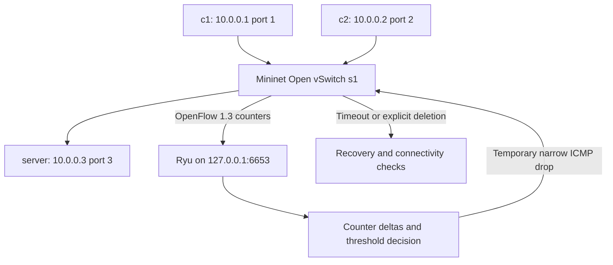

# SDN-Based DDoS Attack Detection and Mitigation

An academic, defensive lab that measures simulated client traffic and temporarily
restricts a client whose ICMP rate exceeds an educational threshold. The second
client stays connected. This is a rate-anomaly demonstration, not a production
security solution or evidence that any observed traffic is an actual attack.

## Problem and terminology

A distributed denial-of-service (DDoS) attack uses multiple sources to overwhelm a
service. High traffic can also be legitimate. This small project demonstrates a
building block for responding to unusual traffic; it does not reproduce a real
DDoS, detect every attack, or guarantee availability.

Software-Defined Networking (SDN) separates forwarding from control decisions.
Mininet creates Linux network namespaces representing hosts and links. Open
vSwitch (OVS) forwards packets using a flow table. Ryu is the Python controller
that installs rules and polls counters. OpenFlow 1.3 is their communication
protocol. Here the controller proactively installs fixed rules rather than
learning MAC addresses, keeping the example small and avoiding packet-in storms.



## Files

```text
config/       lab_config.json and timestamped logging.conf
controller/   config.py, detection.py, mitigation.py, sdn_controller.py
topology/     mininet_topology.py
scripts/      start_controller.sh, start_lab.sh, run_demo.sh, reset_lab.sh
tests/        test_config.py, test_detection.py, test_mitigation.py
docs/         ARCHITECTURE.md, TROUBLESHOOTING.md, INTERVIEW_GUIDE.md, VALIDATION.md
logs/         controller.log at runtime (ignored by Git)
run_tests.py  portable test entry point
requirements*.txt, Makefile, LICENSE, .gitignore, .gitattributes
```

## Windows: edit and test

Use VS Code to open this folder. Ordinary Python 3.8+ can run the portable tests;
Python 3.13.7 was used for the recorded results. No pip packages are needed.

```powershell
cd .\Projects\sdn-ddos-detection-mitigation
python run_tests.py
python -m compileall -q controller topology tests
```

If `python` opens the Microsoft Store, install ordinary Python manually or use
the existing workspace runtime:

```powershell
& ..\python-runtime\python.exe .\run_tests.py
& ..\python-runtime\python.exe -m compileall -q controller topology tests
```

Mininet, Linux namespaces and OVS do not run as this lab natively on Windows.
No WSL, packages or privileged networking configuration are installed by this
project. See [validation](docs/VALIDATION.md) for what was actually run.

## Linux prerequisites and compatibility

Use a disposable, dedicated Linux VM, without any bridge to a physical interface.
The Mininet hosts have no NAT or default route. The controller listens only on
loopback. Do not run this on an existing OVS deployment: the controller replaces
the flow table on datapath 1 and the topology creates the bridge `s1`.

For this legacy Ryu application, use an Ubuntu 20.04-compatible lab image with
CPython 3.8 for the controller, Mininet 2.3.x, and OVS 2.13.x or another OVS version
supporting OpenFlow 1.3. These are **target versions, not an integration-tested
matrix**. The old Python/Eventlet environment is for an isolated academic VM.
Use vendor maintenance/extended support where available. Do not deploy it as a
public service. A modern Linux host can run Mininet separately from a locally
available Python 3.8 controller environment, but the commands below assume 3.8
exists as `python3.8` and system Mininet imports under `/usr/bin/python3`.

Ryu 4.34 expects `eventlet.wsgi.ALREADY_HANDLED`; Eventlet 0.30.3+ removed that API.
The requirements pin Eventlet 0.30.2, dnspython 1.16 and greenlet 1.1.3.post0 for
Python 3.8. Do not install these controller requirements under Python 3.13.
Setuptools is pinned for Ryu's old setup hooks. These pins limit known breakage;
they do not constitute a fully locked or currently supported dependency set.

References: [Ryu maintainer issue](https://github.com/faucetsdn/ryu/issues/138),
[Eventlet Python 3.10 issue](https://github.com/eventlet/eventlet/issues/733),
[OVS OpenFlow version documentation](https://docs.openvswitch.org/en/stable/faq/openflow/),
[Mininet OVSSwitch API](https://mininet.org/api/classmininet_1_1node_1_1OVSSwitch.html).

WSL2 is an optional advanced alternative only if its kernel supports network
namespaces and OVS datapath modules (or an appropriately configured userspace
datapath), OVS services run, and root networking operations work. Merely having
WSL2 installed is insufficient. This project's default kernel-datapath topology
has not been verified in WSL2. A full Linux VM is the clearer starting point.

## Linux setup (manual commands)

Copy/clone this folder into the VM. From its project root, review and run these
commands yourself. `apt` installs system tools; `systemctl` starts OVS. Neither is
run automatically. Obtain a compatible VM/Python first if these packages are not
available from your maintained lab image.

```bash
sudo apt update
sudo apt install mininet openvswitch-switch iputils-ping python3.8-venv python3-dev build-essential libffi-dev libssl-dev
sudo systemctl start openvswitch-switch
python3.8 -m venv .venv-ryu
.venv-ryu/bin/python -m pip install 'pip==23.3.2' 'setuptools==57.5.0' wheel
.venv-ryu/bin/python -m pip install -r requirements-ryu.txt
.venv-ryu/bin/python -c 'import ryu, eventlet; print("Controller imports OK")'
/usr/bin/python3 -c 'import mininet; print("Mininet import OK")'
ovs-vsctl --version
```

Do not globally downgrade Python or system packages. If installation fails, use
[troubleshooting](docs/TROUBLESHOOTING.md); do not silently replace pins with the
newest libraries.

## Start and check the lab

Terminal 1, project root (ordinary user):

```bash
bash scripts/start_controller.sh
```

Terminal 2, project root: the next command uses root to create namespaces, veth
links and the dedicated OVS bridge. Run it manually in the disposable VM.

```bash
sudo bash scripts/start_lab.sh
```

At the `mininet>` prompt:

```text
pingall
c1 ping -c 3 10.0.0.3
c2 ping -c 3 10.0.0.3
sh ovs-ofctl -O OpenFlow13 dump-flows s1
exit
```

Terminal 3, project root:

```bash
tail -f logs/controller.log
```

The server is a simulated IP host answering ping; no external server or Internet
access is needed. Flow counters with cookies `0x101` and `0x102` count each client's
ICMP traffic to that server. Log timestamps use the VM's local timezone.

## Safe demonstration and Linux integration test

Exit any running topology first, leave the controller running, then run manually:

```bash
sudo bash scripts/run_demo.sh
```

This is an executable integration check, not just unit tests. With default config
it checks initial connectivity, observes installation of the mitigation cookie,
checks c1 restriction and c2 connectivity, verifies hard-timeout expiry, and
repeats a short burst to verify explicit removal and restored connectivity.
Assertions or subprocess failures produce a nonzero exit. `finally` stops the
traffic process and tears down Mininet on success or failure.

The only elevated test source is c1, with at most 80 small ICMP requests per burst
at 10 packets/second. There are two bounded bursts. Targets are fixed lab IPs;
there is no user-supplied traffic target, high-volume generator or external scan.
Use defaults for the scripted demo: custom thresholds/windows/timeouts can make
its timing assumptions invalid. Counter log observations during the burst verify
monitoring. Review those logs as well as the demonstration's assertions.

Illustrative output only (not captured from a Linux run):

```text
PASS normal connectivity; starting bounded 10 pps ICMP from c1 for 8 seconds
2026-10-20T12:00:04 INFO ... OBSERVE source=10.0.0.1 packets=40 suspicious=True reason=rate 10.00 pps ...
2026-10-20T12:00:04 INFO ... MITIGATION requested source=10.0.0.1 ...
PASS mitigation observed and c2 unaffected
PASS timeout recovery
PASS explicit removal and recovery; integration demonstration complete
```

## Detection and mitigation

Edit `config/lab_config.json` before starting the controller. JSON avoids a YAML
dependency. All settings are validated; hosts remain fixed for safety and port
mapping consistency. Defaults: poll every 2 seconds, flag **strictly greater than
5 packets/second** for 2 consecutive observations, and drop for 10 seconds.

Rate = change in packet count / actual elapsed monotonic time. The first sample
establishes a baseline. Counter resets establish a new baseline; invalid counts
or non-increasing time raise errors. One brief spike does not trigger mitigation.
Only ICMP client-to-server counters are monitored, not all traffic or bandwidth.

A priority-200 rule with cookie `0xd005` matches IPv4 ICMP, the suspicious source
and `10.0.0.3`. Its empty action list drops those packets. ARP, the other client's
traffic, and other IP protocols continue through lower-priority forwarding rules.
The hard timeout removes the drop automatically. FlowRemoved resets the detector
baseline. Logs distinguish a requested rule from verified switch state; OpenFlow
errors are logged. The integration test checks the actual flow table and pings.

## Recovery and reset

Stop the suspicious ping first. While the lab is running, manually remove only
this application's mitigation rules:

```bash
sudo bash scripts/reset_lab.sh
```

At the Mininet prompt run `pingall` to confirm recovery. Automatic timeout also
works without controller intervention. `exit` tears down the topology; Ctrl+C
stops the controller. After a crash, `sudo mn -c` cleans stale Mininet resources,
but affects other Mininet labs too: use it only in the dedicated VM after closing
all lab processes. No script invokes sudo automatically. Logs can be viewed in
`logs/controller.log`; they are ignored by Git.

## Tests and limitations

```bash
python3 run_tests.py
python3 -m unittest discover -s tests -v
python3 -m compileall -q controller topology tests
```

The two test commands are alternatives. Unit tests do not require Ryu or root;
OpenFlow adapters use mocks, which validate requested message fields, not actual
switch behavior. The Linux integration procedure above is still required.

Limitations: fixed topology and ports, IPv4 ICMP only, no attack classification,
no source authenticity, no adaptive threshold, no multiple-switch support, no
production authentication/TLS, and no persistent controller state. Sustained
traffic can trigger again after recovery; lost FlowRemoved messages can leave
in-memory blocked state stale until a controller restart. A disconnected
controller stops new detection, though hard timeouts still expire existing drops.
Static forwarding is intended only for trusted simulated hosts. High traffic
alone does not prove DDoS; this demo simulates an anomaly, not a distributed attack.

For connection failures, version errors, missing OVS services and stale bridges,
see [TROUBLESHOOTING.md](docs/TROUBLESHOOTING.md). See
[ARCHITECTURE.md](docs/ARCHITECTURE.md) for the data flow and
[INTERVIEW_GUIDE.md](docs/INTERVIEW_GUIDE.md) for questions and simple answers.

## GitHub publishing after review

This directory is an independent Git repository; no commit, remote or push was
created automatically. Review files, `git status`, and `git diff --no-index
/dev/null README.md` (Linux) or open them in VS Code. Logs, caches, virtual
environments, credentials/key files and packet captures are ignored. Inspect
staged content again before committing. Do not put secrets in any tracked file.

After you approve the files, run these yourself from this project root, replacing
the URL with your empty GitHub repository (create it without an initial README):

```bash
git status --short
git add .
git diff --cached --stat
git diff --cached
git commit -m "Build isolated SDN traffic detection and mitigation lab"
git branch -M main
git remote add origin https://github.com/YOUR_USERNAME/sdn-ddos-detection-mitigation.git
git push -u origin main
```

These Git commands also work in PowerShell. If `origin` already exists, inspect
`git remote -v` rather than replacing it. Authenticate through Git's credential
manager or SSH; never paste a token into source or a remote URL. No publication
is claimed until your push succeeds.

## Interview explanation

?I built a local SDN lab with two clients and a server. A Python Ryu controller
reads Open vSwitch counters using OpenFlow. If one client's ICMP rate exceeds a
small threshold for two samples, it installs a temporary rule for that source and
destination. I check that the other client stays reachable and verify recovery.?

Why SDN? It lets control code inspect counters and program switch rules.
Why a timeout? Recovery remains possible even if the controller disconnects.
Is it production DDoS protection? No: this is a narrow, educational rate detector.
What did you test? Portable logic is tested separately from the real Linux lab;
report only integration results you actually observe.
